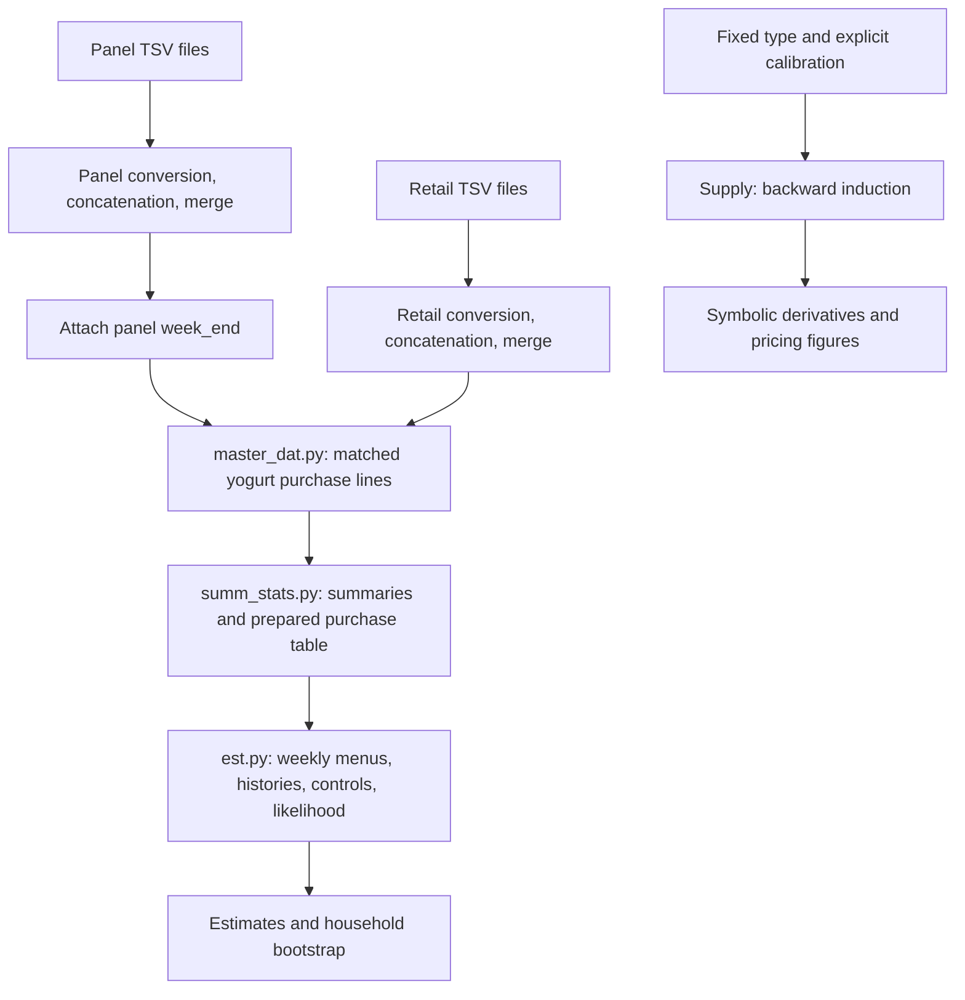

# A reader's guide to the empirical and pricing code

These guides describe the source present on November 1, 2026, including current
working-tree changes. Read them in pipeline order:

1. [Data construction and descriptive statistics](data_code/CODE_GUIDE.md).
2. [Demand estimation and inference](est_code/CODE_GUIDE.md).
3. [Dynamic pricing and comparative statics](supply_code/CODE_GUIDE.md).

Each chapter connects mathematical definitions to functions, intermediate
tables, algorithms, outputs, examples, and interpretation. The guides document
the code; they do not certify the private server data or the model assumptions.

## PDF editions

There are two master books:

- [The current model and pipeline guides](code_guides_pdf/complete_code_guides.pdf):
  data construction, estimation, inference, pricing, and mathematical derivations.
- [The Python 101 code walkthrough](code_guides_pdf/python101_walkthrough.pdf):
  Python foundations, worked reading lessons, actual source listings, each
  function's purpose and alternatives, and statement-by-statement syntax notes.

Each book covers all three code directories and includes a generated table of
contents, PDF bookmarks, wrapped code examples, and page numbers. The Python
walkthrough includes nested functions, test methods, top-level scripts, and empty
package files; its coverage manifest checks for omitted function/statement entries.

Rebuild from the repository's `Code` directory:

```bash
python3 final_draft/build_code_guides.py
python3 final_draft/build_python101.py
```

These use local Pandoc and XeLaTeX and read no private data. The original guides
remain in each code directory. Editable Python lessons are in `python101/`;
the complete generated walkthrough source is `PYTHON101_WALKTHROUGH.md`.
The first builder's optional `--individual` flag also recreates the earlier
individual chapter PDFs; the default writes only the collected current-guide PDF.

## How the components connect



The arrow from estimates to supply is deliberately absent: the current supply
entry point does not load demand estimates. A researcher must explicitly define
that bridge. Demand has three inside flavor groups and a cumulative state index;
supply has one inside product, an outside choice, two periods, and signed last-choice
states. The two gamma parameters therefore do not share a mechanical unit conversion.

## Three meanings of a sample

The full panel consists of recorded purchases in `merged_panel.parquet`; it is
not a roster of every enrolled household including households with no purchases.
The matched yogurt sample contains purchases that survive retail matching,
positive-price filtering, and the two-purchase-week restriction. The final
estimation sample further requires compatible exposure-store menus and usable
instruments, then reapplies the two-usable-week restriction. Its household count
can be smaller than the descriptive sample's count.

## Reading existing documentation

Use the Python source to settle runtime defaults. The estimation README contains
older statements followed by amendments: current bootstrap replications default
to **49**, simulation draws to **128**, and main starts to **3**. For supply,
`MODEL_CONVENTIONS.md` and `comparative_statics/canonical.py` describe the current
symmetric-switching model. Several other supply notes and retained output files
describe superseded models. The chapters below identify those boundaries.

## Current three/five workflow

For the updated empirical code, start with `../final_simple/README.md` and the current-workflow chapter of [Python 101](code_guides_pdf/python101_walkthrough.pdf). The main server command is `sbatch Code/final_simple/server/run_after_data.sh EXISTING_REBUILD_RUN_DIR`. It skips the completed data build, reruns separate three/five summaries, uncontrolled fits and plain/berry pricing, and stages only allowed aggregate outputs. The textbook covers every production Python module in final_simple, including shared classification and server orchestration. Earlier code-guide/model chapters remain historical references; do not substitute their controlled-pricing or combined-gamma submission instructions for the current workflow.
