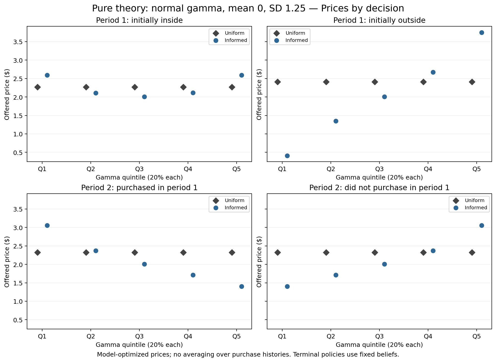
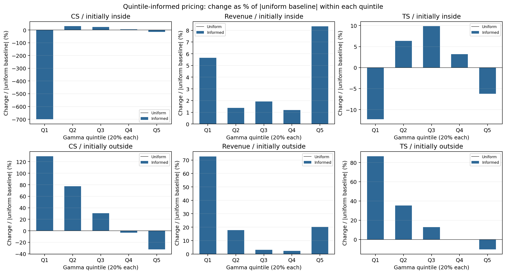
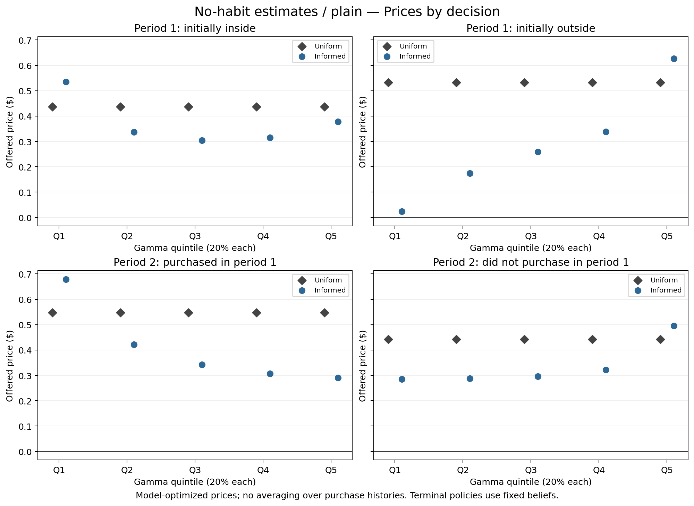
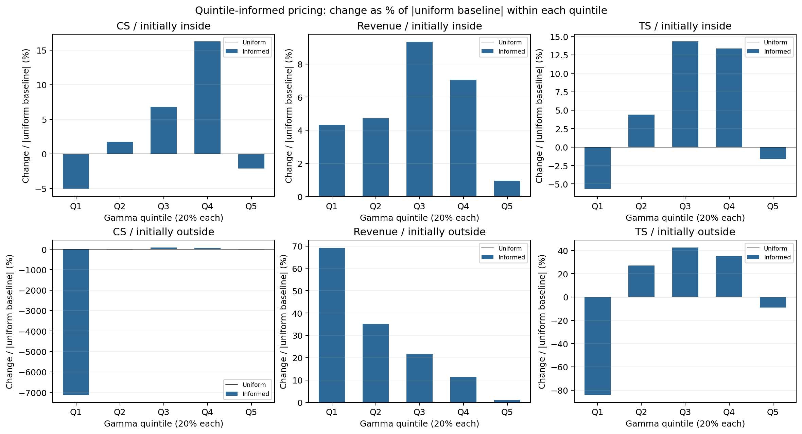
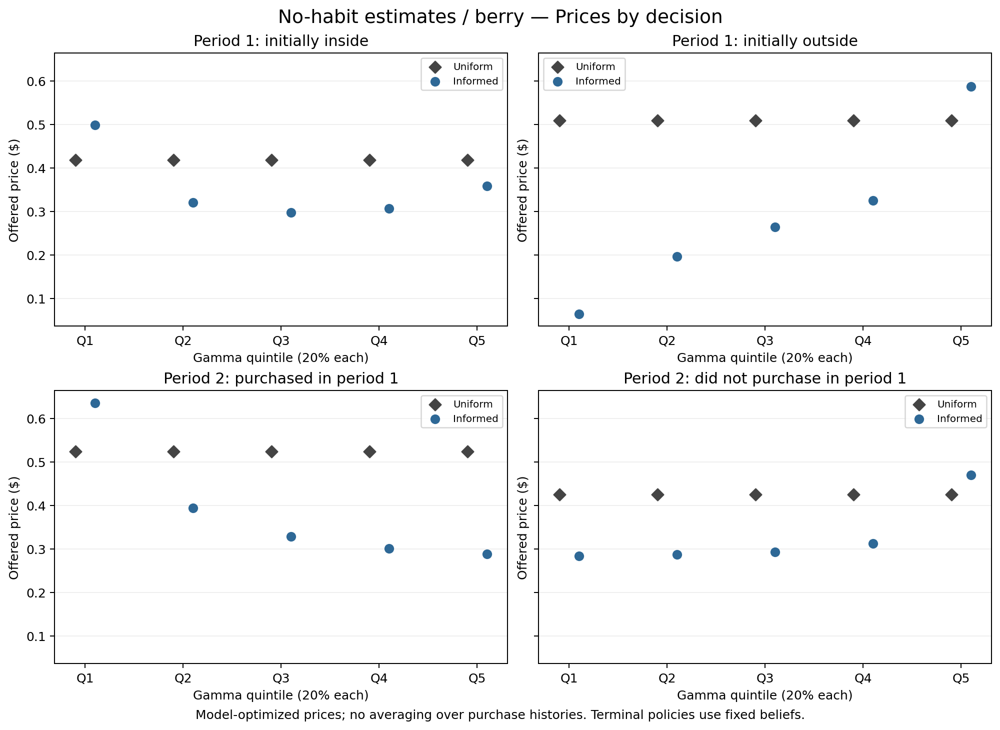
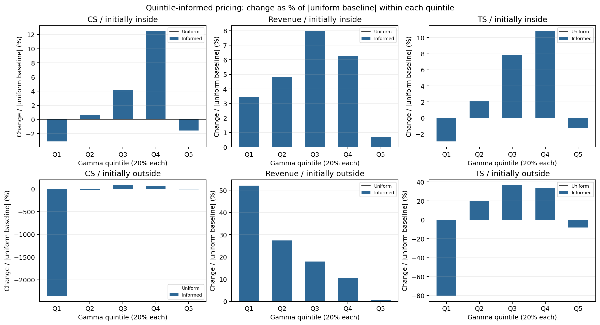
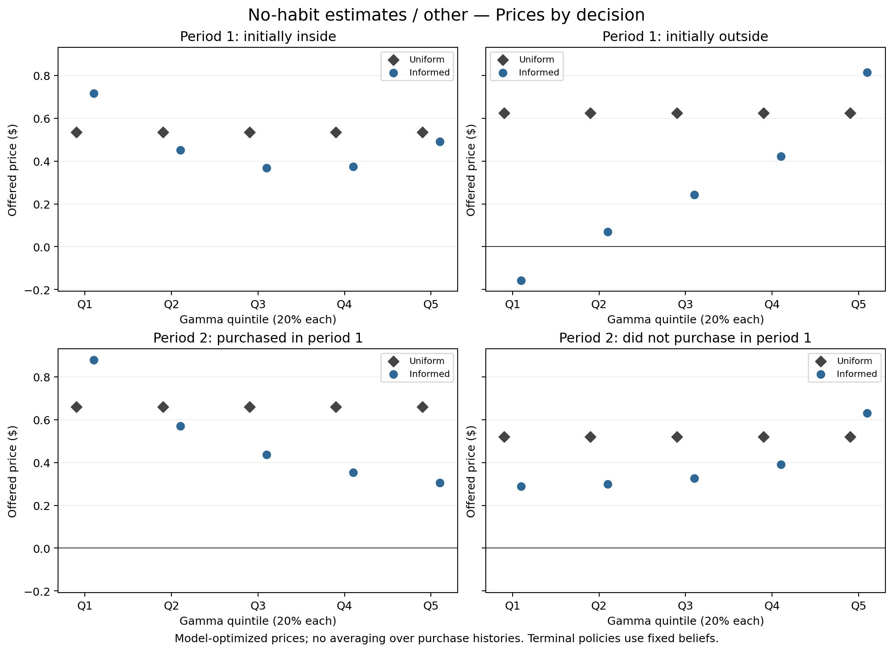
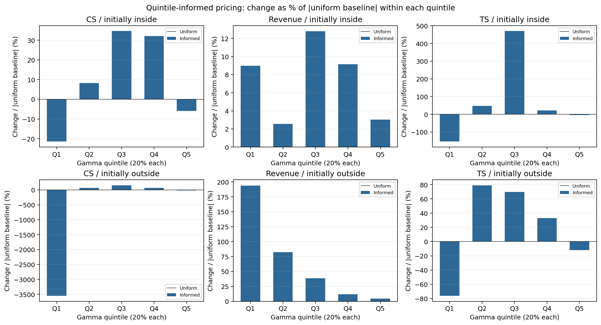

# Supply exercise review

Open **supply_review.pdf** for the complete packet. Each exercise has two pages: four panels of optimized prices, then CS/revenue/TS across all quintiles.

Every quintile contains 20% of its population. The four price panels show period 1 for initially-inside and initially-outside consumers, then period 2 after purchase and nonpurchase. All prices are chosen by the model; none are observed data prices or averages across purchase histories. Uniform knows the quintile mixture but cannot identify membership; Informed knows membership with uncertainty within the quintile.

Welfare and revenue bars show 100 × (quintile-informed − uniform) / |uniform|, using per-consumer conditional means for the same quintile and initial history. Uniform pricing is the 0% baseline; the absolute denominator preserves the direction of improvements when baseline welfare is negative. TS = CS + revenue at zero cost. Gamma persists across periods. Beliefs remain fixed within the observed bin or full population.

Pure theory assumes normal gamma (mean 0, SD 1.25), beta 2, alpha -1, delta 1. Applied exercises use the newly estimated novelty_only model without habit. All flavor intercepts, mean price sensitivity, and gamma distribution parameters come from that fit. No demand model is refitted here.

The old three-point-prior and quadrature display versions are superseded here by the matching quintile versions. Each folder includes PNG/PDF figures, numerical outcomes, uniform population paths, settings and source provenance.

Source: /scratch/dtm63837/Kilts_Panel/rebuilds/run_49942107/fits/separate_experiments_50281568/novelty_only/point_estimates.csv

These are the binary theory exercises populated with no-habit estimates. Pricing retains fixed beliefs; reported outcomes and the introductory objective integrate the same persistent types. Terminal offers optimize under unchanged beliefs; no learning occurs. The uniform firm knows all five quintile distributions and weights but cannot identify individual membership.

Initialization uses the first actual observed yogurt basket for each included household. Focal purchase sets h0=j; no focal purchase sets h0=0. The next two consecutive purchase weeks are counterfactual pricing periods; they need not be consecutive calendar weeks. Future purchases are generated under optimized prices, not copied from observed future choices. No observed prices are imposed on either period.

State-conditional panels show the same policies regardless of initial-state frequencies: gamma beliefs are explicitly held identical across h0. The observed_initialization_* tables combine states using actual household counts. Quintiles remain equal-probability bins of the fitted population distribution, not household posterior-mean ranks. No learning is introduced.

## Pure theory: normal gamma, mean 0, SD 1.25

## No-habit estimates / plain

## No-habit estimates / berry

## No-habit estimates / other

