# Supply exercise review

Open **supply_review.pdf** for the complete packet. Each exercise has two pages: overlaid expected price paths, then CS/revenue/TS across all quintiles.

Every quintile contains 20% of its population. Five informed paths and exactly one population-uniform path appear in each initial-history panel. The firm knows the quintile, with uncertainty within it. Uniform offers can depend on purchase history; their displayed E[p2] is averaged over the full population.

Welfare bars are per-consumer conditional quintile means under each policy. TS = CS + revenue at zero cost. Gamma persists across periods. Beliefs remain fixed within the observed bin or full population.

Pure theory assumes normal gamma (mean 0, SD 1.25), beta 2, alpha -1, delta 1. Applied exercises use the saved aggregate estimates. The corrected observed-week fit is recomputed with quintiles to match the earlier fit; no demand model is refitted.

The old three-point-prior and quadrature display versions are superseded here by the matching quintile versions. Each folder includes PNG/PDF figures, numerical outcomes, uniform population paths, settings and source provenance.

## Pure theory: normal gamma, mean 0, SD 1.25

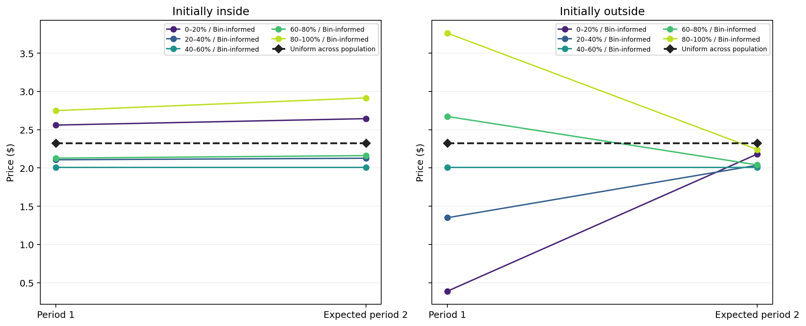

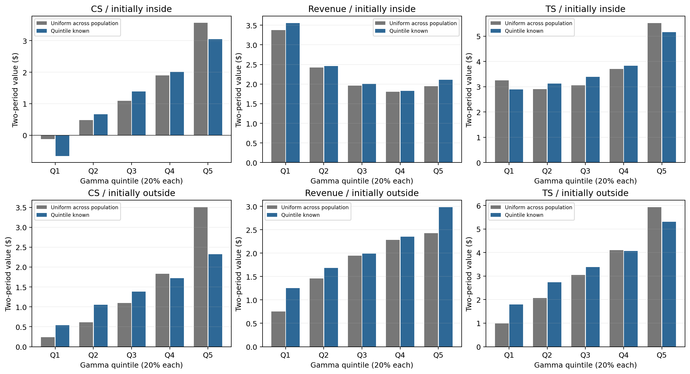

## Applied / earlier fit / plain

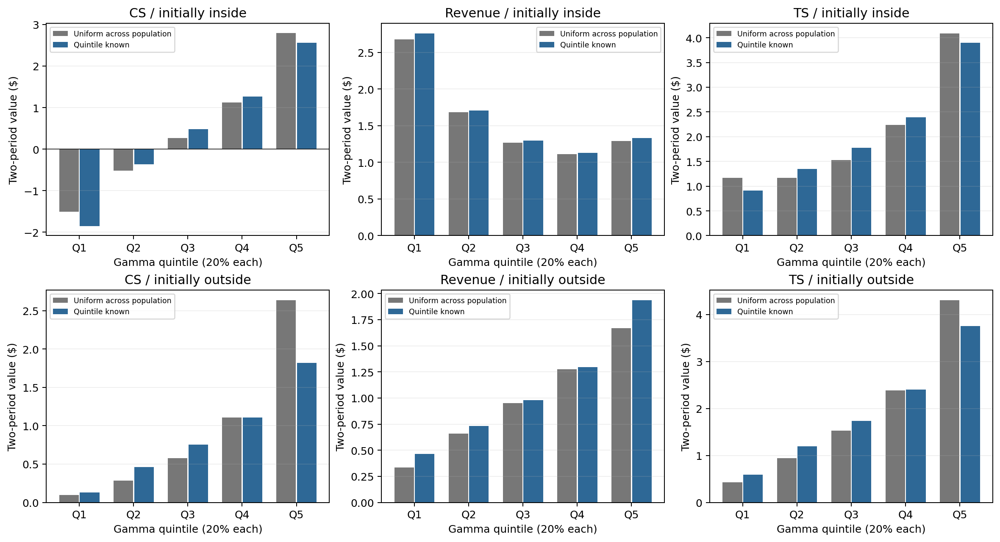

## Applied / earlier fit / berry

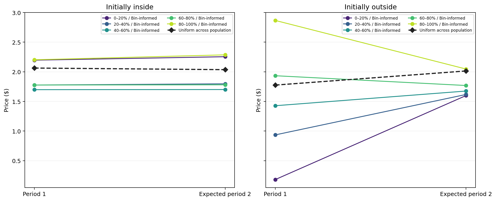

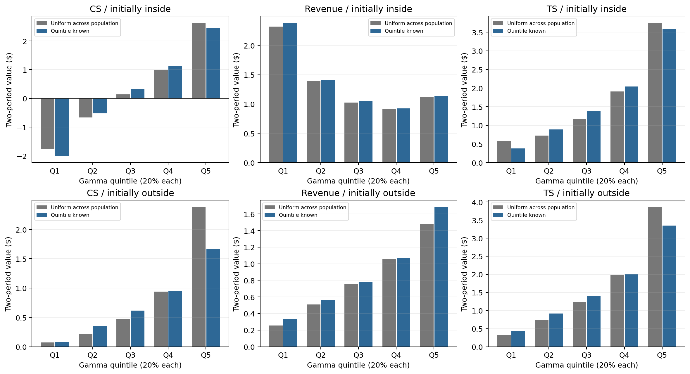

## Applied / earlier fit / other

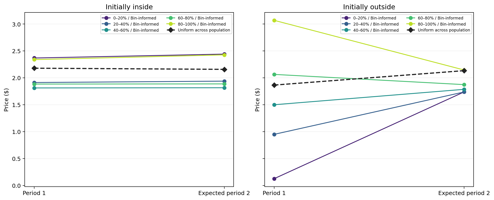

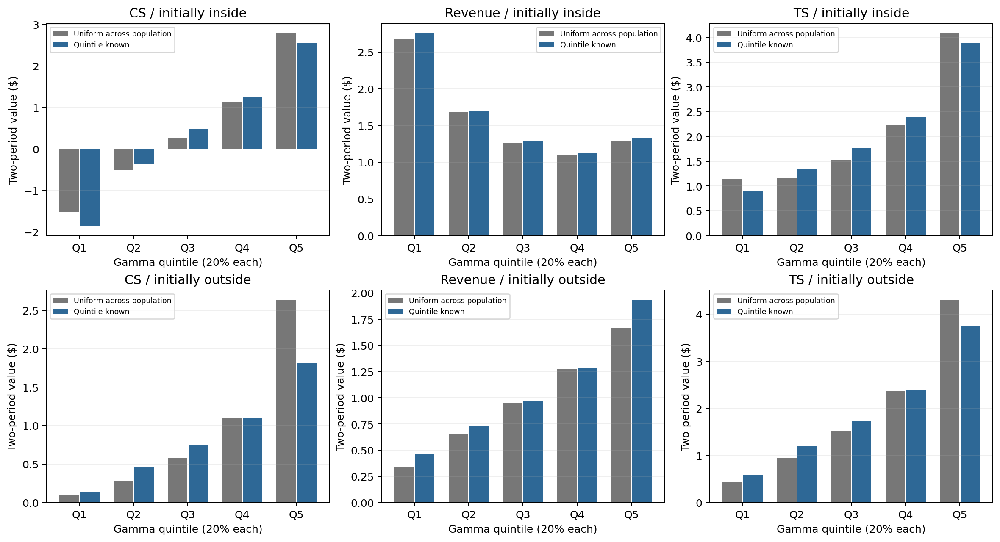

## Applied / observed week 128 / plain

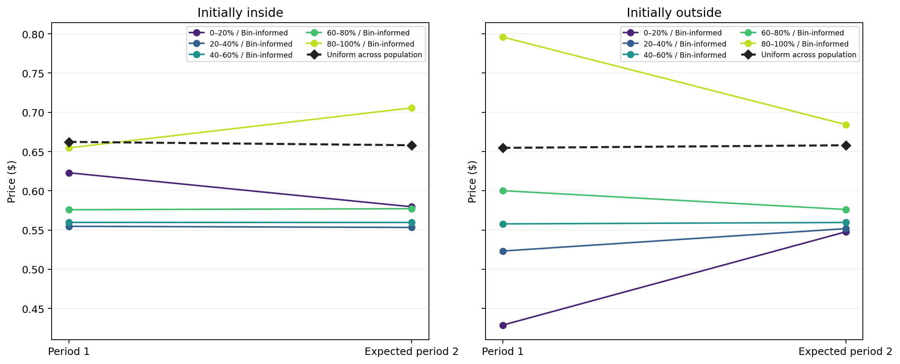

## Applied / observed week 128 / berry

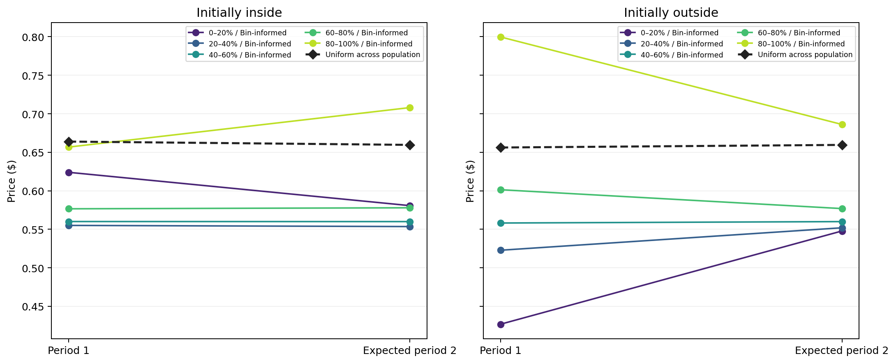

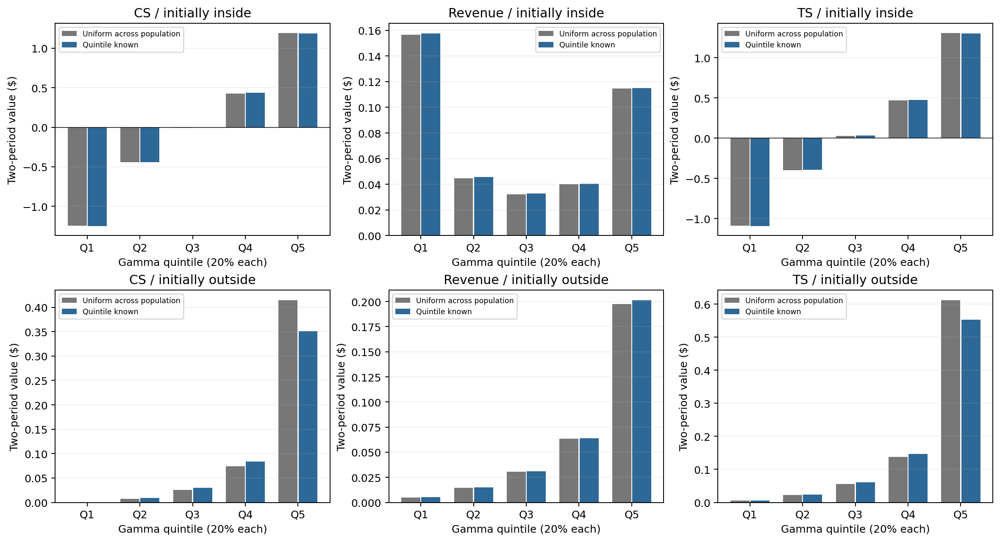

## Applied / observed week 128 / other

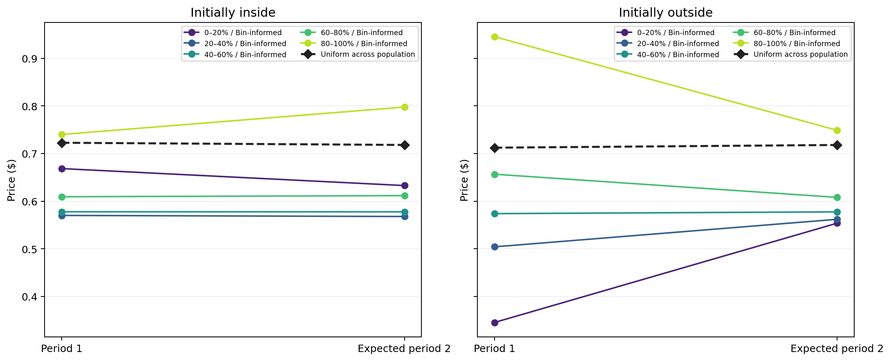

